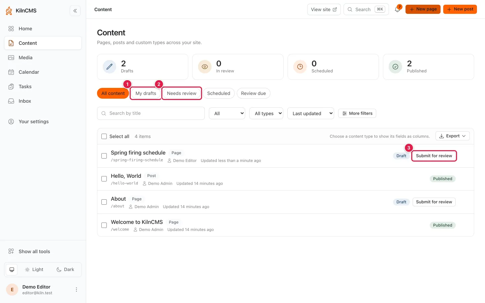
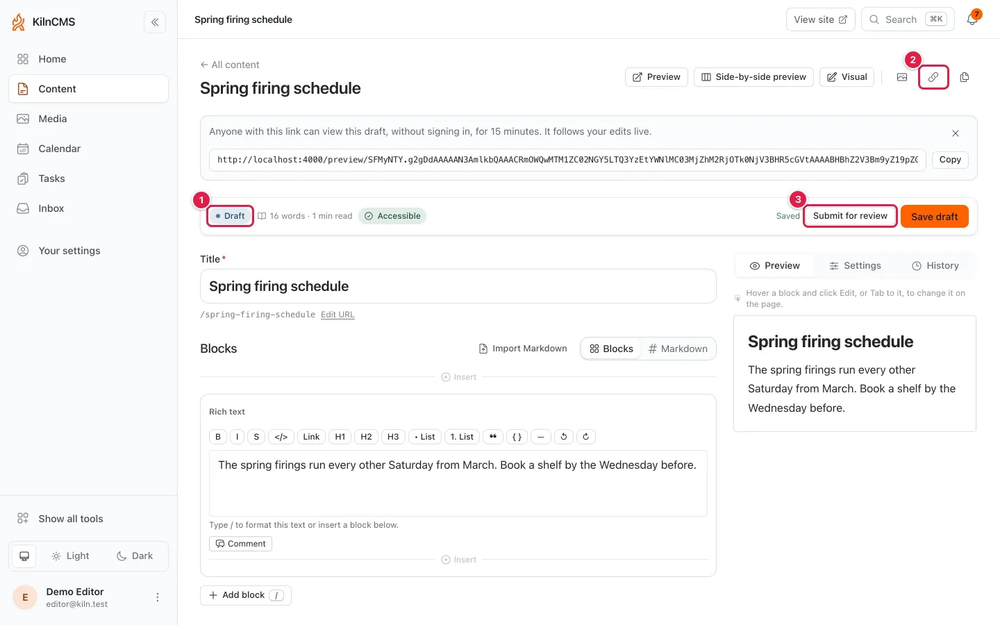
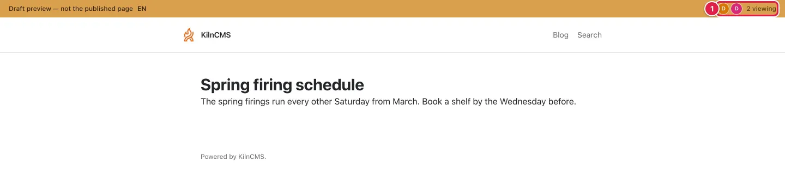
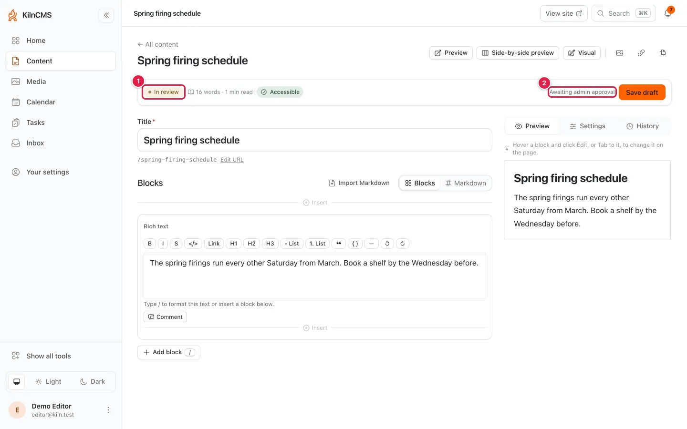
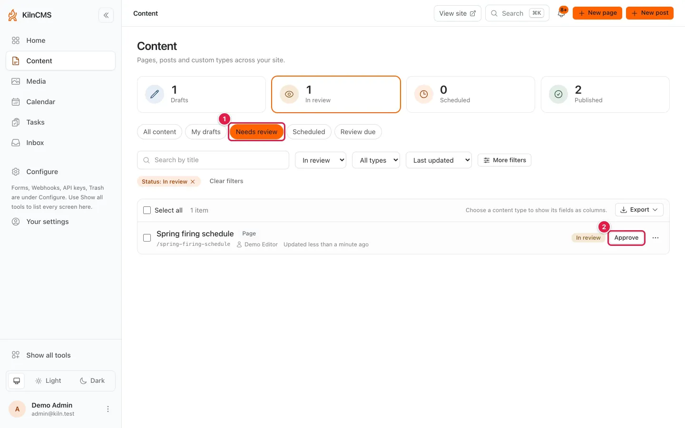
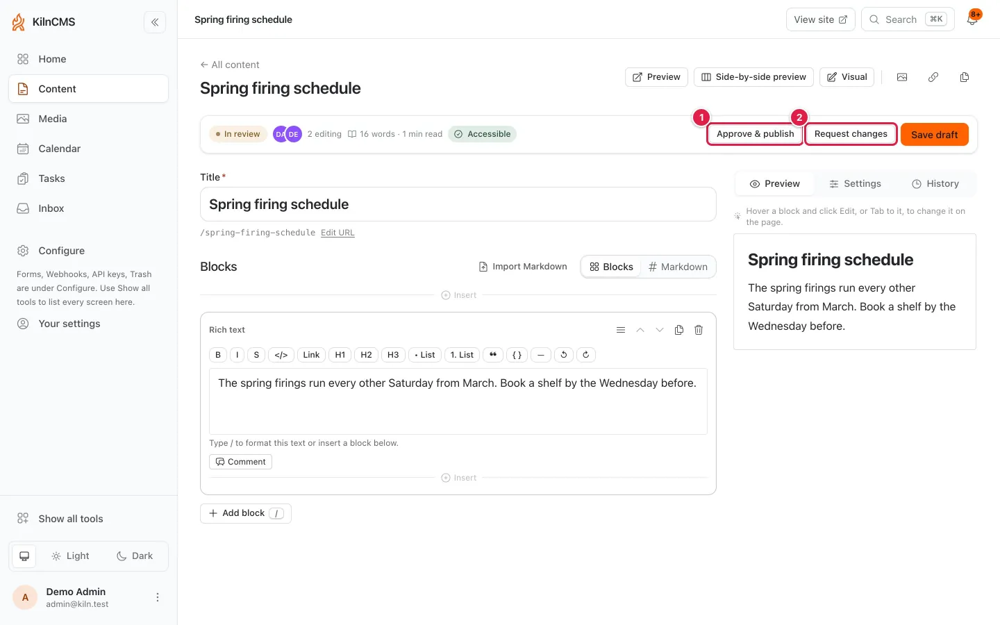
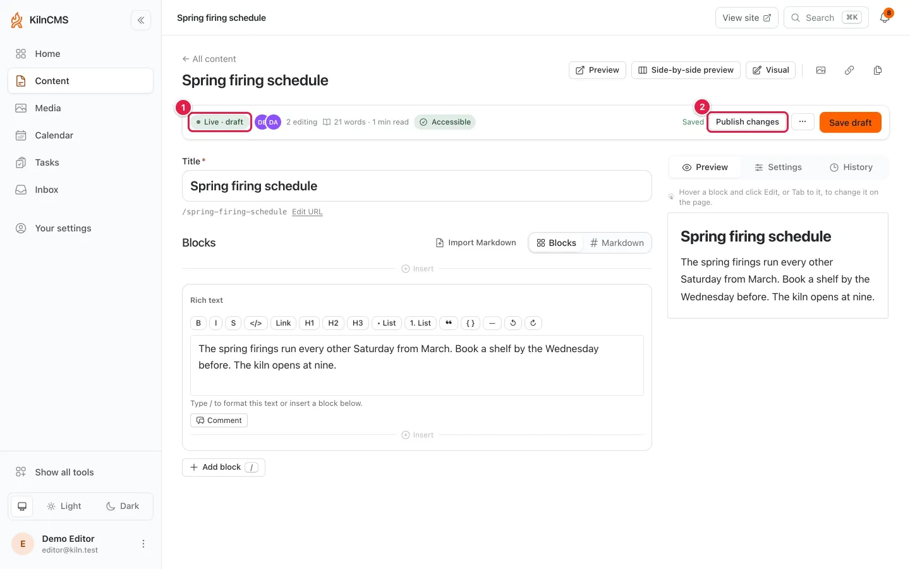
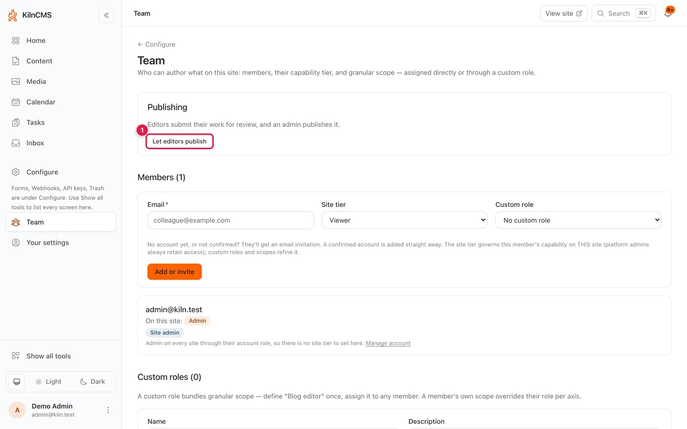

# The editorial workflow

<!-- seo-description: How a page goes from draft to review to published in
Kiln, what viewers, editors and admins can each do, and how to preview,
schedule, change and take down live content. -->

This guide follows one page from its first draft to a live change, in about
five minutes. It covers what each role can do at every step, and where to read
more.

Kiln has three roles on a site. A **viewer** reads published content. An
**editor** writes drafts and submits them for review. An **admin** approves and
publishes, and decides whether editors may publish their own work.

## The states a document is in

| State | What it means |
|---|---|
| **Draft** | Work in progress. Only editors and admins can see it. |
| **In review** | Submitted for review and waiting for an admin. |
| **Published** | Live. Anyone the page's audience allows can read it. |
| **Live · draft** | Published, with edits saved but not yet live. Readers still see the published text. |
| **Archived** | Taken down and filed away. Unarchiving brings it back as a draft. |

## Who can do what

<!-- role-matrix:start -->
| Action | Viewer | Editor | Admin |
|---|---|---|---|
| Read published content | Yes | Yes | Yes |
| Create and edit drafts (`create`, `update`) | No | Yes | Yes |
| Preview a draft and copy a preview link | No | Yes | Yes |
| Submit for review (`submit_for_review`) | No | Yes | Yes |
| Publish now or on a date (`publish`, `publish_scheduled`) | No | If editors may publish | Yes |
| Set the publish date (`scheduled_at`) | No | If editors may publish | Yes |
| Propose a publish date (`proposed_publish_at`) | No | Yes | Yes |
| Request changes (`return_to_draft`) | No | No | Yes |
| Put edits to a live page live (`publish_changes`) | No | Yes | Yes |
| Unpublish or archive (`unpublish`, `archive`) | No | If editors may publish | Yes |
| Set the unpublish date of a live page (`unpublish_at`) | No | If editors may publish | Yes |
| Restore an earlier version (`restore_version`) | No | Yes | Yes |
| Delete, and restore from the trash (`destroy`, `restore`) | No | No | Yes |
| Turn the Team → Publishing switch on or off | No | No | Yes |
<!-- role-matrix:end -->

"If editors may publish" depends on the site's **Team → Publishing** switch.
The first-run `/setup` asks, and its default lets editors publish; a site that
never answered (an upgraded install, say) keeps it off. Granular permissions can narrow an editor further,
for example to some content types only ([Granular RBAC](granular-rbac.md)).
The [policy matrix](policy-matrix.md) lists every resource and action.

The walkthrough below is shot on a site where only admins publish. Where
editors may publish, an editor also sees **Publish** next to **Submit for
review**.

## 1. Write a draft

Open **Content**, choose **New**, then **New page** (or the type you need). The draft
saves as you type.

1. **My drafts** lists the drafts you wrote.
2. **Needs review** lists everything waiting for an admin.
3. A draft's row offers its next step. For an editor that is
   **Submit for review**.

## 2. Preview it, and share it

1. The state of the document: **Draft**.
2. **Copy preview link** makes a link for someone without an account. It shows
   this one draft, follows your edits live, and stops working after 15
   minutes.
3. **Submit for review** hands the draft to an admin.

**Preview** opens the page as readers will see it, in a new tab. Everyone with
the preview open sees who else is looking.

1. Two people are viewing this preview. Comments and cursors are covered in
   [Multiplayer preview](multiplayer-preview.md).

## 3. Submit it for review

1. The state is now **In review**.
2. An editor sees **Awaiting admin approval** and can keep editing.

## 4. Review it

An admin finds submitted work under **Needs review**. This is the queue of
work waiting to be published. It is not the same as **Review due** or
**Never reviewed**, which list published content due to be re-read
([Content lifecycles](content-lifecycles.md)).

1. **Needs review**: everything in review.
2. **Approve** publishes the page straight from the list.

To read it first, open the page. Use [Discussions](comments.md) to comment on
a block.

1. **Approve & publish** puts it live now.
2. **Request changes** sends it back to the editor as a draft.

## 5. Publish now, or on a date

An admin publishes now, or sets **Scheduled publish at** in the page's
**Settings** and saves. Where editors may not publish, an editor fills in
**Proposed publish date** instead. The admin sees the proposal on the page and
on the calendar, and chooses **Use this date** to schedule it. To publish
several pages together, use a [content release](content-releases.md).

## 6. Change a live page

Editing a published page does not change what readers see. Your edits go to
the page's working copy until someone publishes them.

1. **Live · draft**: published, with edits waiting.
2. **Publish changes** puts the edits live.

Editors can publish changes on every site, by design. The switch decides who
makes a page live the first time; once it is live, an editor's edits there are
already theirs to make. [The working copy](working-copy.md) explains this,
along with discarding changes and restoring earlier versions.

## 7. Take it down

**Unpublish** returns a live page to a draft, and **Archive** files a page
away. Both need publish rights, and Archive does even on a draft. Any editor
may **Unarchive**, which brings a page back as a draft.

**Unpublish** is on the page's editor (under **More actions** on a
**Live · draft** page) and in a published row's menu. Tick rows in the
content list to **Unpublish** or **Archive** them together. On a live or
scheduled page, **Scheduled unpublish at** in **Settings** is an unpublish
too, so it is locked for anyone who may not publish.

Deleting moves a page to the trash, and only an admin can delete it or restore
it from there ([Trash and restore](trash.md)).

## Who may publish

1. **Let editors publish** gives editors the publish, schedule and unpublish
   rights in the table above. **Require admin approval** takes them away
   again. Editors can still submit for review either way.

Team is platform-admin only; site admins choose once, in **Home**'s **How do
you publish?**

Roles are given on the same page; see
[Account administration](account-administration.md).

## Where next

- [The working copy](working-copy.md): editing live pages, and version history.
- [Content releases](content-releases.md): publishing several changes at once.
- [Discussions](comments.md): comments and tasks during review.
- [Multiplayer preview](multiplayer-preview.md): previewing together.
- [Content lifecycles](content-lifecycles.md): review dates and expiry.
- [Policy matrix](policy-matrix.md): every permission, resource by resource.
- [Account administration](account-administration.md) and
  [Granular RBAC](granular-rbac.md): roles and narrower grants.
- [Trash and restore](trash.md): getting deleted content back.
