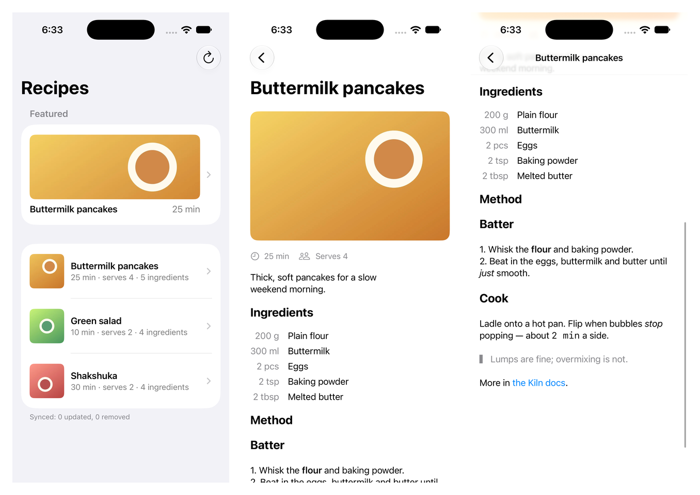

# SwiftUI reader

A small iOS/macOS app that reads a Kiln site the way
[docs/native-apps.md](../../docs/native-apps.md) recommends: generated
`Codable` models, a local mirror kept fresh by `/api/sync`, and native
rendering with no web view. It's smaller than a client SDK. Copy the parts
you need.



| Piece | File | Shows |
|---|---|---|
| Models | [`Sources/KilnModels/Kiln.swift`](Sources/KilnModels/Kiln.swift) | Output of `mix kiln.export.schema --format swift`, checked in |
| Client | [`KilnClient.swift`](Sources/KilnReader/KilnClient.swift) | `GET /api/content/:type/:slug?surface=json` with `If-None-Match` → `304`, `?fields=` in canonical spelling, `GET /api/sync`, error codes |
| Sync | [`SyncEngine.swift`](Sources/KilnReader/SyncEngine.swift), [`Mirror.swift`](Sources/KilnReader/Mirror.swift) | Initial → cursor → deltas with deletions; the cursor saved atomically with each page; restart with `initial=true` only on `invalid_cursor`; `Retry-After` and jittered backoff |
| Rich text | [`PortableText.swift`](Sources/KilnReader/PortableText.swift) | Portable Text → `AttributedString`, with the plain rendition as the fallback |
| Media | [`MediaLayout.swift`](Sources/KilnReader/MediaLayout.swift) | Picking a variant for the frame's pixel width, reserving space from `width`/`height`, cropping around `focal` |
| Screens | [`Views.swift`](Sources/KilnReader/Views.swift), [`Reader.swift`](Sources/KilnReader/Reader.swift) | A list fed by the mirror (plus a `?fields=` featured card), a detail screen with `:group` rows as a native grid |

## Run it

You need a local Kiln (see the [main README](../../README.md)) and Xcode 16
or later.

**1. Start Kiln with the demo content.** From the Kiln checkout's root:

```bash
mix setup
```

```bash
mix run examples/swiftui-reader/kiln/seed.exs
```

```bash
mix phx.server
```

The seed ([`kiln/seed.exs`](kiln/seed.exs)) adds an admin-defined `recipe`
type and publishes three recipes. Each field kind the app renders natively
is there:

- `ingredients`, a repeating `:group` field (item, amount, unit);
- `method`, a rich `:text` field with *Also deliver as plain text*, *Keep
  paragraph breaks* and *Also deliver as Portable Text* ticked;
- `hero`, a `:media` image with a focal point. The seed waits for its
  variants.

Check it: `curl 'http://localhost:4000/api/sync?initial=true&type=recipe'`.

**2a. macOS.** From this directory:

```bash
swift run SwiftUIReader
```

**2b. iOS Simulator.** Generate the Xcode project with
[XcodeGen](https://github.com/yonaskolb/XcodeGen) (`brew install xcodegen`).
The `.xcodeproj` is gitignored; `project.yml` is the source:

```bash
xcodegen
```

```bash
open SwiftUIReader.xcodeproj
```

Run the `SwiftUIReaderApp` scheme on a simulator. The simulator reaches the
Mac's `localhost` directly. `Info.plist` allows plain HTTP to local
addresses only (`NSAllowsLocalNetworking`).

Point either at another Kiln with `KILN_URL` (an environment variable, or
the scheme's *Run → Arguments* in Xcode). `KILN_FEATURED` picks the
featured recipe's slug.

## Tests

```bash
swift test
```

- **Decoding**: the generated models against JSON captured from a real
  local Kiln ([`Tests/KilnReaderTests/Fixtures`](Tests/KilnReaderTests/Fixtures)):
  a fired `json` artifact, a `?fields=` response, a snapshot page and a
  delta page with a deletion.
- **Portable Text**: marks, links (including a blanked unsafe `href`),
  headings, quotes, numbered and nested lists, unknown node types.
- **Media**: variant choice and focal-point cropping.
- **Sync**: the page loop, cursor persistence, the `invalid_cursor` restart,
  `503`/`429`/network retries and giving up, `304`, the `?fields=` spelling.
  It runs against a stubbed `URLProtocol`, so it needs no server.

CI runs them on macOS when this directory or the Swift emitter changes
(`.github/workflows/swiftui-reader.yml`).

## Regenerating

After changing the `recipe` type's fields, or after a Kiln upgrade that
changes the emitter or adds a block:

```bash
bin/regenerate
```

```bash
bin/capture-fixtures
```

`bin/regenerate` runs `mix kiln.export.schema --format swift --type recipe`
in this checkout against the dev database. It takes `KILN_ORG_ID` for a site
other than the default. `bin/capture-fixtures` re-reads the fixtures from the
running server (`KILN_URL`, default `http://localhost:4000`). To capture a
delta with a deletion, it unpublishes `green-salad`, reads the delta and
publishes it again.

## Notes on the choices

- **Anonymous reads.** The app sends no credential. Published, public content
  needs none, and an API key in an app binary is a key anyone can extract.
- **The mirror is one JSON file**, replaced atomically per sync page, so the
  page's documents and its cursor are always written together. A larger
  corpus wants SwiftData, Core Data or SQLite. The rule is the same: one
  transaction per page, with the cursor in it. Documents are kept as raw
  JSON (`JSONValue`) and decoded when read. A key this build has no model
  for survives until the models are regenerated.
- **Restart only on `invalid_cursor`.** Local data is kept through the new
  snapshot. The ids it sends are recorded (and persisted, so an interrupted
  restart can resume), and anything not sent is deleted when it ends. Every
  other error retries the same request: `Retry-After` when given, otherwise
  2, 4, 8 … seconds with jitter, five attempts per wake.
- **Portable Text through its own node type.** The generated
  `PortableTextBlock` is the schema's open node. It declares only `_type`
  and `_key`, because Portable Text is an extensible convention, so decoding
  through it drops the spans. The renderer decodes the same JSON into
  `PortableTextNode`. It renders both a `rich_text` block's `body` and a
  field's `custom_fields_portable` value, which have the same shape.
- **`?fields=` for the featured card, sync for the list.** The list is the
  mirror, and pull-to-refresh is one sync delta, not one request per row. The
  featured card at the top is the widget case `?fields=` exists for. It reads
  `title,slug,custom_fields.hero,custom_fields.minutes` into its own small
  `RecipeCard` type and revalidates by `ETag`. A detail screen revalidates its
  document the same way, and an unchanged recipe is a `304`.
- **Background refresh** isn't wired up. `SyncEngine.run()` is what a
  `BGAppRefreshTask` handler calls. Fetch, save and finish within the budget;
  the stored cursor carries the rest to the next wake.
